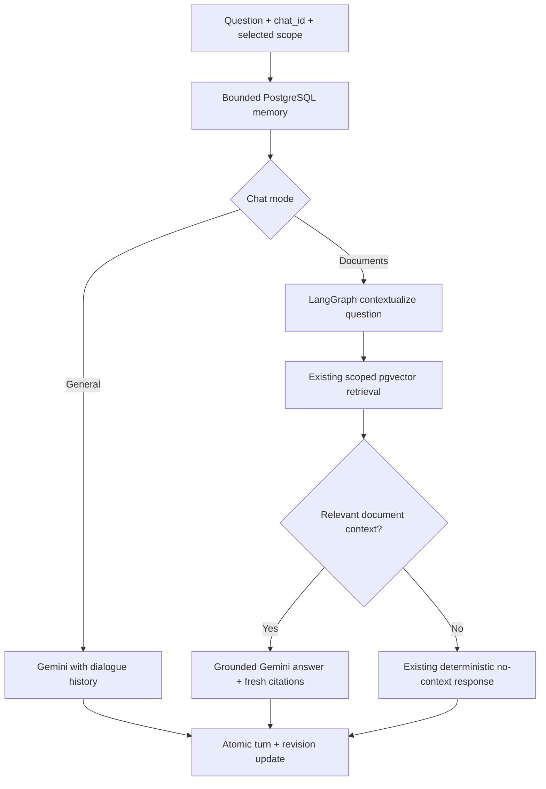

# Feature 1: persistent conversation memory

> Historical increment report: Feature 5 now supplies history management and changes New Chat to retain earlier documents. See [the current history report](feature5-history.md).

This report records the original memory-only increment. Feature 4 now adds ownership,
authenticated sessions and migrations; use [the current authentication report](feature4-authentication.md)
for deployment and current security status.

## Architecture before and after

Before: React held ephemeral messages. General chat sent only the current question
to Gemini. RAG embedded only the current question, and then retrieved, generated and
built citations. PostgreSQL held documents, chunks and truncated audit records.

After: both chat endpoints optionally use the existing `chat_id` to load indexed,
bounded PostgreSQL history. General chat sends typed system/user/assistant messages.
RAG extends the same graph with a follow-up contextualization node before retrieval.
The existing pgvector filters, no-context branch, grounded prompt, citations and
audit logging remain. Completed exchanges persist in one transaction with a
conversation revision check. No new runtime dependencies or deployment-file changes.



## Behavior and decisions

- A supplied chat ID opts into memory. Omitting it preserves legacy stateless
  behavior. No globally shared conversation or model checkpoint is used.
- Scope is `general`, `all`, or `document:<id>`. Changing scopes starts an independent
  memory window within the same conversation. Returning to a scope resumes its history.
- Context uses at most `MEMORY_MAX_TURNS` successful exchanges and
  `MEMORY_MAX_CHARS` content characters. Oldest exchanges drop from prompts; complete
  stored transcripts remain unchanged. An oversized most-recent pair is trimmed.
- A follow-up with prior RAG history makes an additional Gemini rewrite call, with
  the existing timeout/retry settings. Rewrite failure falls back to the original
  question. Both rewrite and answer tokens count in the result. This can add latency
  and cost; neither latency improvements nor RAG quality scores have been measured.
- History provides conversational context, never independent document evidence.
  No freshly retrieved context means the same deterministic fallback. Citation lists
  still represent retrieved source chunks, not automated claim verification.
- Successful and no-context exchanges persist with full question/answer text,
  citations, token usage and scope. No-context exchanges are excluded from subsequent
  prompts. Provider/empty failures are excluded from memory.
- Revision compare-and-update rejects concurrent stale completion with HTTP 409.
  The client surfaces the retry message and does not automatically re-send. A losing
  request may already have consumed Gemini tokens; no partial exchange is stored.
- PostgreSQL persistence survives backend restarts for the same chat ID. The current
  browser UI does not yet restore that ID on reload or reopen old conversations.
- The client now sends its conversation ID to both endpoints and generates it using
  `crypto.randomUUID()` (modern HTTPS browsers/localhost). Late answers/document
  responses cannot populate a newly reset chat. Existing New Chat document cleanup
  remains, and it does not delete stored transcripts.

## Migration and deployment

`migrations/001_conversation_memory.sql` creates only `conversations`,
`conversation_turns`, a uniqueness constraint and a history index. It does not alter
or delete documents, chunks or audits. The runner executes all statements in a
transaction and can be rerun. There is no destructive down migration.

Use the production database credentials already managed in your environment:

```bash
cd /home/ankesh/ALEX/Alex
source venv/bin/activate
python -m app.core.migrate
```

Run this before deploying the updated backend. A failure exits nonzero; resolve it
before deployment. Development startup also registers the new models through the
existing `create_all`, but startup remains best-effort and is not migration evidence.
Production readiness and a general versioned migration framework are later work.

For an existing Compose deployment with PostgreSQL already provisioned:

```bash
docker compose build web
docker compose run --rm --no-deps web python -m app.core.migrate
docker compose up -d web
```

Inside Compose, configure `DATABASE_URL` with hostname `postgres`, rather than
`localhost`. The CLI running on your host uses your host-accessible database URL.
On Railway, run `python -m app.core.migrate` through the project's existing release
or service shell before deploying. Keep existing Docker/Railway/Vercel settings;
build the frontend with `npm run build` and use the existing Vercel deployment.
No deployment to a live service was performed by this change.

## Install, run and test

For a fresh checkout:

```bash
python3 -m venv venv
source venv/bin/activate
pip install -r requirements.txt
pip install pytest flake8
cp .env.example .env
# Configure .env with your database and Gemini credentials.
docker compose up -d postgres
python -m app.core.migrate
uvicorn app.api.main:app --host 0.0.0.0 --port 8000 --reload
```

In a second terminal:

```bash
cd frontend
npm install
npm run dev
```

Verification:

```bash
source venv/bin/activate
pytest tests/ -q
pytest tests/test_conversation_memory.py -v
flake8 app --jobs=1 --select=E9,F63,F7,F82 --show-source --statistics
cd frontend
npm test
npm run build
```

Optional real database verification (requires a separately provisioned disposable
database; never supply your application database):

```bash
# Set MEMORY_TEST_DATABASE_URL through your environment to a disposable
# PostgreSQL database named alex_memory_test*.
pytest tests/test_memory_postgres.py -v
```

Example API use: send `{"question":"My name is Ada","chat_id":"chat-example"}`
to `/api/v1/chat/general`, then send `{"question":"What is my name?","chat_id":"chat-example"}`
to the same endpoint. Use the same ID in `/api/v1/chat` and document uploads for
document follow-ups. Questions are capped at 12,000 characters; chat IDs are at most
64 ASCII letters/digits/underscores/hyphens; RAG `top_k` is 1–100.

## Verification results

Verified on October 13, 2026 using the existing Python 3.14.4 virtual environment
and Node 22.22.1 installation:

| Check | Result |
| --- | --- |
| Untouched baseline (`898aa29`, temporary Git snapshot) | 54 backend tests passed |
| Existing tests plus new memory tests | 81 backend tests passed |
| Real PostgreSQL 16/pgvector disposable container | 3 integration tests passed |
| Migration | Applied twice on empty/ORM-created SQLite schemas and real PostgreSQL; stored data preserved |
| Simultaneous PostgreSQL first turns | One exchange committed, one conflict; no partial/duplicate turn |
| Frontend API tests (`npm test`) | 5 passed |
| Frontend production build (`npm run build`) | Passed |
| Python CI fatal-error lint selection, single worker | Passed |
| Whitespace check (`git diff --check`) | Passed |
| Frontend lint | Not available: repository has no lint script/configuration |
| Browser smoke test with real PostgreSQL and a deterministic mock LLM | Follow-up recalled Ada; New Chat forgot Ada; delayed old answer did not appear in new chat |
| Live Gemini generation/evaluation | Not run; no production Gemini calls or quality metrics claimed |
| Authentication/user ownership | Absent; conversation/scope isolation tested, authenticated user isolation remains unimplemented |

The PostgreSQL container used localhost-only access, a generated temporary password,
and ephemeral storage. It and both smoke-test servers were stopped after verification.
Application databases, secrets and deployment configuration were not changed.
Sandboxed TestClient stalled even in the existing health test; rerunning outside
the sandbox resolved it. An initial timestamp default mismatch was fixed before the
passing final checks. Existing embedding tests downloaded/cached their model.

Browser proof uses a mock model, not Gemini:


## Modified and added files

- `app/models/conversation.py` (new): conversation revisions and completed turns.
- `app/models/__init__.py`, `app/core/db.py`: register new models with existing startup.
- `app/services/conversation_memory.py` (new): bounded history, atomic persistence and concurrency checks.
- `app/services/rag_service.py`, `app/agents/rag_agent.py`: memory integration, contextualization, grounding and token accounting.
- `app/api/schemas.py`, `app/api/v1/endpoints/chat.py`: optional general-chat ID, validation, memory and retryable storage/conflict errors.
- `app/config.py`, `.env.example`: configurable history bounds.
- `app/core/migrate.py`, `migrations/001_conversation_memory.sql` (new): explicit additive migration runner and DDL.
- `frontend/src/App.jsx`, `frontend/src/services/api.js`: chat-ID propagation, secure random IDs, duplicate-send and stale-response guards.
- `frontend/package.json`, `frontend/tests/api.test.js` (new test file): native Node test command and API behavior tests.
- `tests/test_conversation_memory.py`, `tests/test_memory_postgres.py` (new): unit/API/graph/migration and real database regression checks.
- `README.md`, `docs/upgrade-plan.md`, `docs/feature1-memory.md`: architecture, roadmap, commands, limitations and verification.
- `docs/verification/memory-new-chat.jpg` (new): mock-backed browser verification screenshot.

An untracked `:memory:.ses` file appeared during the initial test setup before code
changes and was left untouched; it is not part of this increment.

## Remaining limitations and next increment

Authentication and ownership are not implemented. Anyone who knows a chat ID can
request its memory; existing unscoped document endpoints can disclose chat IDs.
Do not roll this increment out as a public multi-user service. Add users and secure
sessions with ownership checks on every document/conversation/retrieval operation
next, then build conversation CRUD and the sidebar.

New Chat still removes previous documents, so stored old citation references can
point to deleted documents. Transcript deletion, retention policy and reopening
belong to the authenticated history increment. Prompts are bounded, but storage is
not yet capped or automatically expired. Remembering facts beyond the recent window
requires future summarization; no summary is invented here.

Live Gemini quality, rewrite accuracy and rate-limit behavior need a credentialed
evaluation run. This increment adds deterministic mocked regression coverage and
real storage checks; it does not implement Feature 6 or claim evaluation metrics.
SSE/cancellation, hybrid ranking, asynchronous ingestion, stronger upload/path
validation, database readiness, dependency pinning and frontend linting remain in
the [prioritized upgrade plan](upgrade-plan.md).
